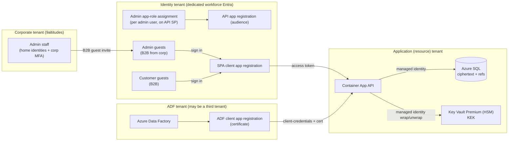

# Authentication & Access

This document is the **authoritative, end-to-end specification for authentication, authorization,
and secret handling** for the Customer Onboarding Portal — for **customer users**, **admins**, and
the **ADF reporting identity**. Where it changes an earlier decision, the reversal is called out
explicitly and captured in an ADR.

It supersedes the identity/secret mechanics previously described in `docs/security-design.md` §3–§5
and `docs/api-design.md` ("Auth models" / "Access control model"), and is the reference those
documents now point at. See [ADR-0005](./adr/0005-dedicated-workforce-tenant-invite-only-access.md),
[ADR-0006](./adr/0006-three-router-authorization-and-adf-certificate.md), and
[ADR-0007](./adr/0007-secrets-in-database-envelope-encryption.md).

---

## 1. What changed, and why

Three deliberate reversals of earlier design, decided in a grilling session:

| Area | Was | Now | ADR |
|---|---|---|---|
| Customer identity | Entra External ID (CIAM) external tenant, **open self-registration** | **Dedicated workforce Entra tenant**, customers are **B2B guests**, **self-service sign-up off**, **invite-only** | 0005 |
| Admin role source | Admins all-scope via a role claim; access granted by a manual link after open sign-up | **Invite-only**; admins are **B2B guests** (home: 9altitudes corporate tenant) whose authority is a **direct `Admin` app-role assignment** on their user, managed **from the portal** via Microsoft Graph | 0005, 0011 |
| ADF auth | Managed identity / workload-identity federation, **no stored credential** | Separate **client app registration** authenticating with a **certificate** (ADF cannot use federated credentials) | 0006 |
| Customer secrets | **Never in our DB** — written through to an **external secret vault** | **Stored in our DB** under **application-layer envelope encryption**; the external vault is removed | 0007 (supersedes 0001) |

> **Amendment ([ADR-0009](./adr/0009-no-machine-secret-consumer.md)):** a later decision removed the
> **machine secret-consumer** — there is **no** onboarding/provisioning pipeline that reads secrets,
> and there never will be. `Secret.Consume`, its pipeline client, and the `/extract/secrets/consume`
> endpoint are gone; **admin reveal is the sole secret read path.** Secrets still live in our DB under
> envelope encryption (ADR-0007 stands, narrowed). The `/extract/*` router keeps only the
> `Extract.Read` reporting identity.

The threat model is otherwise unchanged: **assume-breach / zero-trust**, with the platform/DB
operator, external attackers, and a **compromised admin** all treated as partially untrusted. The
one unavoidably-trusted component remains the backend Container App, which sees plaintext in memory
(see §11.5 and `security-design.md` §1.1).

---

## 2. Identity topology

Three Entra tenants, kept apart on purpose:

- **Identity tenant** — a **dedicated, standard workforce Entra tenant** for 9altitudes-hosted
  applications (separate from the corporate directory and from the resource tenant). **"Dedicated"
  means workforce-identity isolation, *not* exclusive to this portal: the tenant hosts more than one
  application, and this portal is one of several app registrations in it.** It holds the **portal's
  access-control objects** (the API/SPA app registrations, the app roles and their assignments)
  alongside other apps' registrations, and **every human is a B2B guest here** — there are **no member
  humans**. Admins are guested in from the **9altitudes corporate tenant** (their home directory);
  customer users are guested in from their own organizations (or as one-off B2B identities). It is
  **not** the corporate directory and **not** the tenant the application's Azure resources live in.
  Customers therefore never appear in the corporate directory, and identity administration is
  isolated from infrastructure administration ("separate responsibilities").
- **Corporate tenant (9altitudes)** — the **home directory of admin staff**. Admins authenticate
  against it (with corporate MFA / Conditional Access) and are then admitted to the identity tenant
  as guests via cross-tenant access settings. The portal never manages corporate identities; it only
  manages a guest's `Admin` app-role assignment in the identity tenant.
- **Application (resource) tenant** — where the Container App, Azure SQL, Key Vault, APIM, and the
  application's managed identities live. Inbound tokens issued by the identity tenant are validated by
  the **platform** — Azure Container Apps built-in authentication — which injects the pre-validated
  principal into the request; the API **trusts that principal and performs authorization only** (see
  [ADR-0010](./adr/0010-platform-authentication-via-container-apps-built-in-auth.md)). The API's own
  Azure access uses **managed identities in the resource tenant**. The two roles never mix.



### 2.1 App registrations and the `Admin` app role

- **One API app registration** in the identity tenant is the **audience** for every portal call. It
  exposes app roles (four in total; see [ADR-0012](./adr/0012-four-app-roles-assignment-required.md)).
  **Sign-in requires being an invited guest AND holding one of the human roles** — the API's service
  principal has *Assignment required* = true, so a role-less guest gets no token:
  - **`Admin` / `PM` / `User`** — the human roles. Each is assigned **directly to the individual
    user** (an `appRoleAssignment` on this app's service principal; **no group** — a group
    assignment would need Entra ID P1, see
    [ADR-0011](./adr/0011-admin-app-role-assigned-directly-to-users.md)), so an assigned user
    receives e.g. `roles: ["Admin"]` in their token. One role per user.
  - **`Extract.Read`** — machine **reporting** access (dashboard feeds, no secrets); assigned to the
    **ADF client app registration**. This is the **only** machine role; there is no machine path that
    returns secret values (see [ADR-0009](./adr/0009-no-machine-secret-consumer.md)).
- **SPA client app registration** — the React single-page app (admin + customer views). Public
  client; tokens are acquired interactively and never leave the browser's memory (see §7). Its
  **Single-page application redirect URIs** must include both the app origin (`https://<swa-host>/`,
  plus `http://localhost:5173` for local dev) **and** `https://<swa-host>/blank.html` (plus
  `http://localhost:5173/blank.html`): MSAL's silent flows (`ssoSilent`/`acquireTokenSilent`) run in
  a hidden iframe and redirect to the lightweight `frontend/public/blank.html` instead of reloading
  the whole app in the frame — without this URI registered, silent sign-in fails with an
  `AADSTS` redirect-URI mismatch.
- **ADF client app registration** — a **separate** confidential client (see §10).

### 2.2 Why admin lives in Entra, not the DB

The role decision (`Admin` / `PM` / `User`) is authoritative in the **signed token** (`roles` claim), never in the
database. Because the threat model treats the DB/operator layer as untrusted, a database compromise
or a SQL bug **cannot mint an admin** — there is no `role` column at all. Roles are stored only in
Entra; the admin user list reads them live via Graph.
This keeps ADR-0002's "admins all-scope via a role claim" intact.

---

## 3. Provisioning: invite-only, one atomic admin action

Self-service sign-up is **disabled** in the identity tenant. A person becomes able to sign in **only
by being invited from the portal admin view**.

### 3.1 The invite is an email-bound record, not a bearer token

An earlier "app-generated invite link/token" design was rejected because a leaked link could let
anyone impersonate the intended user. That rule stands: **the portal never emails a secret that
grants access.** An invite is a **record binding a specific email address to a role (+ customer
scope)**; portal access is derived only from a **verified Entra identity plus our own `Users` /
`UserCustomers` rows** — never from possession of a link.

The Entra **B2B invitation** redemption link (Microsoft-managed) is *different in kind*: it only
confers **directory guest status** after the invitee authenticates (with MFA), and confers **no
portal access on its own**. A leaked redemption link therefore yields nothing usable in the portal.

### 3.2 One admin action, three effects (atomic)

Submitting the admin **Invite** form performs, as one unit of work:

1. **Microsoft Graph** creates an **Entra B2B guest invitation** for the email — regardless of role,
   every human enters the identity tenant as a **guest** (an admin invite targets the person's
   **9altitudes corporate email**, so redemption federates to the corporate tenant; a customer invite
   targets their work email). Entra owns the redemption, email verification, and MFA.
2. A **`Users` row** is created (or reused if the email already exists) recording the person and
   their role.
3. Scope is provisioned:
   - **role = user** → one or more **`UserCustomers`** links (the customer(s) they may see), plus
     optional primary-contact / initial task assignments.
   - **role = admin** → the invitee (an admin **guest**, homed in the corporate tenant) receives a
     **direct `Admin` app-role assignment** on their user via Graph (no customer link; admins are
     all-scope).

The link-creation step emits an **audit entry** (see §12). Re-inviting an existing email never
duplicates the identity — it only adds the link/role.

### 3.3 The invite email

A plain notice — *"You've been invited to the 9altitudes onboarding portal; sign in at
&lt;portal-url&gt;"* — carrying **no secret**. (The Entra B2B redemption link, if used, is
Microsoft's and is covered by §3.1.)

---

## 4. Authorization model

### 4.1 Two independent dimensions

- **Role** (admin vs user) — authoritative as the **`Admin` app-role claim** (§2.2).
- **Customer scope** (which customers a user may see) — from **`UserCustomers`**, enforced inside
  the database by **EXECUTE-only stored procedures** (ADR-0002). The app's SQL principal cannot run
  a raw cross-tenant query even with a code bug. All external identifiers are GUIDs; authorization
  is **deny-by-default**.

### 4.2 Three authorization tiers, guarded once in central composition

Authorization is enforced **at the tier**, not per-endpoint, so no individual endpoint can be
accidentally left under-protected. Each feature module exposes a **bare** `APIRouter` (no prefix,
no guard); a single composition module (`app.api`) mounts each under its tier, which carries the
URL prefix and a **mandatory router-level guard** — so the tier/guard pairing is declared exactly
once and a new module is secured simply by mounting it under the right tier:

| Router | Prefix | Router guard | Accepted identity | Scope resolution |
|---|---|---|---|---|
| **Admin** | `/api/v1/admin/*` | `require_admin` | **admin guest** with `roles: ["Admin"]` | all-scope |
| **Customer** | `/api/v1/portal/*` | `require_portal_user` | any authenticated caller (a **customer-scoped guest** *or* an **admin**) | in the database, per query, from the caller's `oid` + admin flag (admin → all; guest → own `UserCustomers`, may be empty) |
| **Extract (ADF)** | `/api/v1/extract/*` | `require_extract_client` | machine client with `roles: ["Extract.Read"]` (reporting), **no user context**, `appid` allowlist (Container Apps auth `allowedApplications`; ADR-0010) | n/a (machine feed) |

Deliberate choices:

- **Admins may act on both the admin and customer routers.** An admin calling a customer endpoint
  acts within the **specific customer named in the request** (e.g. to fill in or preview a wizard on
  the customer's behalf). The portal guard resolves **identity and role only**; **customer scope is
  enforced in the stored procedures** (ADR-0002), not by the guard. An authenticated caller with no
  `UserCustomers` links is **not** rejected — its in-scope set is simply empty (an empty list / 404),
  the truth for an unscoped user, so authorization never depends on the app loading scope.
- **Defence in depth at the token layer:** the machine caller is a **separate app registration** with
  a **distinct app role** (`Extract.Read`, reporting only) — a customer or admin token can never
  satisfy the extract guard even if a guard were mis-wired, and a machine token can never reach
  admin/customer routes.
- The extract router is **machine-only**: it carries no user identity and is never accepted on the
  interactive per-project routes (and vice-versa).
- **The portal tier also carries the role-agnostic `whoami` echo** (`/api/v1/portal/whoami`, the
  `session` module): any authenticated caller may read its **own** validated claims — a diagnostic,
  not customer data — so it needs the portal guard (authenticated) but no customer scope. It lives in
  its own module because echoing a caller's claims is not user management.
- **Customers have no separate admin surface.** The portal customer reads already resolve all-scope
  for an admin, so there is no `/api/v1/admin/customers`; the admin tier currently carries user
  management (the `users` module) only. (Genuinely admin-only customer *management* — e.g. creating a
  customer — would be a new admin-tier endpoint, distinct from this scoped read.)

**Baseline authentication is mounted once.** In `app.api`, the three tiers are themselves mounted
under a single deny-by-default `APIRouter(dependencies=[Depends(validated_token)])`, so authentication
applies to all of them and a newly added tier cannot be accidentally left unauthenticated. The
per-tier **role** guards above layer authorization on top (each also depends on `validated_token`,
which FastAPI caches per request, so it runs once). `app.main` includes that composed router; only
`/health` and `/api/v1/ping` are registered directly on the app, **outside** it — the platform's
health probes and the post-deploy smoke test reach them without a token.

### 4.3 Tier composition sketch (illustrative)

```python
# Each feature module exposes a BARE router (no prefix, no guard), e.g.
#   app/modules/users/router.py      -> router = APIRouter()  # /invitations, /users/...
#   app/modules/customers/router.py  -> router = APIRouter()  # /customers, /customers/{id}
#   app/modules/session/router.py    -> router = APIRouter()  # /whoami
#   app/modules/extraction/router.py -> router = APIRouter()  # /customers (machine feed)

# app/api.py gives each tier its prefix + guard ONCE, then mounts the bare routers.
admin_tier   = APIRouter(prefix="/api/v1/admin",   dependencies=[Depends(require_admin)])
portal_tier  = APIRouter(prefix="/api/v1/portal",  dependencies=[Depends(require_portal_user)])
extract_tier = APIRouter(prefix="/api/v1/extract", dependencies=[Depends(require_extract_client)])
admin_tier.include_router(users_router)
portal_tier.include_router(customers_router)
portal_tier.include_router(session_router)
extract_tier.include_router(extraction_router)

def require_admin(principal: ClientPrincipal = Depends(validated_token)):
    if "Admin" not in principal.roles:
        raise HTTPException(403)
    return AdminPrincipal(oid=principal.oid)

def require_portal_user(principal: ClientPrincipal = Depends(validated_token)):
    # Identity + role only — no DB lookup, no customers-domain import. Each portal
    # endpoint passes (oid, is_admin) to its stored procedure, which enforces
    # customer scope in the database (ADR-0002); an unscoped caller simply matches
    # no rows (empty list / 404), so there is no 403 for "authenticated but unscoped".
    return PortalPrincipal(oid=principal.oid, is_admin="Admin" in principal.roles)

def require_extract_client(principal: ClientPrincipal = Depends(validated_token)):
    if "Extract.Read" not in principal.roles or principal.appid is None:
        raise HTTPException(403)
    # Container Apps built-in auth has already checked appid against allowedApplications (ADR-0010).
    return ExtractPrincipal(appid=principal.azp, roles=principal.roles)
```

**Where `validated_token` gets its claims:** token *validation* is performed by the **platform**
(Azure Container Apps built-in auth), which injects the pre-validated principal into the request.
`validated_token` therefore **parses the injected principal** (`X-MS-CLIENT-PRINCIPAL`) into a typed,
immutable `ClientPrincipal` rather than verifying a JWT in-process — the guards above read its
attributes (see
[ADR-0010](./adr/0010-platform-authentication-via-container-apps-built-in-auth.md)).

The database stored procedures are the **second** enforcement layer beneath these guards; the guard
decides *who*, the procedure re-checks *what customer* on every read/write.

---

## 5. Sign-in security (MFA, Conditional Access, sessions)

Enforced in the **identity tenant** by Conditional Access; carried over unchanged from
`security-design.md` §5 and reaffirmed here because customer secrets now live in our database.

- **Admins (guests, home = 9altitudes corporate tenant):** **phishing-resistant MFA** (Microsoft
  Authenticator device-bound passkey or Windows Hello for Business — no hardware purchase required),
  enforced in the **corporate tenant** and **honoured by the identity tenant's Conditional Access via
  cross-tenant inbound MFA trust** (so the strong factor is satisfied once, at the home tenant).
  Legacy auth blocked, **non-persistent** browser session, sign-in frequency **~8h**.
- **Customer users (guests):** **app-based MFA required** (Authenticator / device-bound passkey),
  enforced by CA in our tenant with **cross-tenant inbound MFA trust** configured so we honour and
  require it. **SMS and email OTP are not accepted as the MFA factor** (phishable / SIM-swappable);
  email verification is still mandatory at sign-up but is not an MFA factor. Sign-in frequency **~24h**.
- **Continuous Access Evaluation (CAE) on** — de-provisioning (deactivation, unlink, disabled/risky
  user) takes near-real-time effect rather than waiting for token expiry.

**Scope the policies to this portal's apps.** The identity tenant hosts **more than one application**
(see §2), so every Conditional Access policy above **targets this portal's cloud apps**
(`cop-api-<env>`, `cop-spa-<env>`) rather than *All cloud apps* — other apps in the tenant keep their
own policies and are unaffected. The grant control (MFA), the session controls (sign-in frequency,
non-persistent browser session) and the legacy-auth block are all per-app assignable. The one
exception is the **cross-tenant inbound MFA trust**, which lives in **External Identities →
Cross-tenant access settings** and is keyed per **partner organization**, not per app; it only
changes behaviour for guests invited from that corporate tenant, so with invite-only provisioning its
blast radius is already narrow.

---

## 6. User lifecycle (admin view)

The admin **Invite** form collects **email** and **role** (`user`/`admin`); for `user`, the
**customer(s)** to link and optional **primary-contact** / initial **task assignments**.

Lifecycle actions:

- **Resend** — Graph re-issues the B2B invitation; no app secret involved.
- **Revoke pending** — cancel an invitation before redemption.
- **Edit access** — add/remove `UserCustomers` links; **promote/demote** by creating/removing the
  user's `Admin` app-role assignment.
- **Deactivate (soft)** — remove all links and the `Admin` app-role assignment; **CAE** cuts access
  near-real-time; the Entra guest object is retained for audit.
- **Delete (hard)** — block/remove the Entra guest object entirely.

---

## 7. Browser session hardening (React SPA)

Unchanged from `security-design.md` §5.5 and mandatory:

- **Access token in memory only** — never `localStorage`/`sessionStorage`. The **refresh token** is
  an `HttpOnly; Secure; SameSite=Strict` cookie, with **CSRF protection** on every cookie-backed
  state-changing request.
- **Strict Content-Security-Policy** (`default-src 'self'`; no inline/eval; explicit allowlist for
  APIM + required Azure endpoints), plus HSTS, `X-Content-Type-Options: nosniff`, a restrictive
  `Referrer-Policy` and `Permissions-Policy`.
- **Output-encode all customer-authored content** (comments, field values) as inert text — no
  `dangerouslySetInnerHTML`, no HTML/Markdown rendering of customer input, **especially in the admin
  UI**, to prevent stored-XSS pivoting an admin session.

---

## 8. Admin management, entirely from the portal

Adding or removing an admin must never (after bootstrap) require the Entra admin center:

- Admin status **is** a **direct `Admin` app-role assignment** on the user (an `appRoleAssignment` on
  the API app's service principal) — **no group**, so **no Entra ID P1** (see
  [ADR-0011](./adr/0011-admin-app-role-assigned-directly-to-users.md)).
- The **portal backend creates/removes that assignment via Microsoft Graph**, so admins are
  invited/promoted/demoted from the portal UI.
- The **first admin is bootstrapped in the Entra admin center** — Enterprise applications →
  `cop-api-dev` → Users and groups → assign your user the `Admin` role — which also serves as the
  manual fallback outside the portal.
- The portal's Graph permission is **`AppRoleAssignment.ReadWrite.All`** (app-only, admin-consented).
  It is tenant-wide / high-privilege; accepted for this dedicated identity tenant and covered by an
  **audit entry on every assignment change** (§12).

---

## 9. Data model touchpoints

- **`Users`** — one row per invited identity (Entra `oid`, email, sign-up/redeemed
  timestamps). It holds no role: roles exist only in Entra (§2.2, ADR-0012).
- **`UserCustomers`** — many-to-many user↔customer scope; the join enforced inside stored procedures.
- **`Customers`** — customer records.
- **`Secrets`** (new, separate schema) — encrypted secret values and lifecycle state (§11).
- **Audit log** — append-only; the app principal cannot `UPDATE`/`DELETE` it (§12).

---

## 10. ADF / reporting identity

- **Separate client app registration** in the identity tenant (or a federated arrangement across the
  ADF tenant), granted the **`Extract.Read`** app role on the API and **nothing else**. This is the
  only machine identity; there is **no** machine secret-retrieval identity or path (see
  [ADR-0009](./adr/0009-no-machine-secret-consumer.md)).
- **Authenticates with a certificate** (client-credentials). ADF **cannot** use workload-identity
  federation for REST/Web linked services, and managed identity is unreliable against a custom-API
  audience across tenants — a certificate is the supported secretless-ish path. The certificate
  lives in ADF-side Key Vault and is **rotated on a schedule**. A client secret is a documented
  fallback if certificate management proves too heavy.
- **This is a mild reversal of `security-design.md` §5.4** ("no client secret or certificate stored
  anywhere") — see [ADR-0006](./adr/0006-three-router-authorization-and-adf-certificate.md) and
  residual risk R5 (§13).
- The caller's `appid` is validated against an **allowlist** by **Container Apps built-in auth**
  (`allowedApplications`, in this repo's Bicep; see
  [ADR-0010](./adr/0010-platform-authentication-via-container-apps-built-in-auth.md)); APIM, if
  present, only routes to `/api/v1/extract/*` and is **no longer** the authoritative allowlist. The
  **reporting** feeds (`Extract.Read`) never carry secret values, and there is **no** machine
  endpoint that returns secrets (§11.4).

---

## 11. Secret storage, encryption, retrieval, and disposal

**This reverses [ADR-0001](./adr/0001-secrets-written-through-to-external-vault.md) and
`security-design.md` §3–§4.** The external secret vault and the separate secrets-management team are
**removed**; the portal now **owns the full secret lifecycle**, because the external vault is
unavailable and admins need a first-party, audited reveal path. See
[ADR-0007](./adr/0007-secrets-in-database-envelope-encryption.md) and
[ADR-0009](./adr/0009-no-machine-secret-consumer.md) (**admin reveal is the sole secret read path;
there is no machine secret-consumer**).

### 11.1 Posture

Customer secrets remain the **crown-jewel asset** and the **DB/operator layer is still untrusted**.
Secrets are therefore stored under **application-layer envelope encryption**, so a database
compromise alone yields only ciphertext.

### 11.2 Encryption

- Each secret value is encrypted with **AES-256-GCM** (authenticated encryption; detects tampering)
  using a **random per-value nonce**. We store **ciphertext + nonce + auth tag + key-version** — never
  plaintext.
- The value is encrypted under a random **Data Encryption Key (DEK)**; the DEK is **wrapped by a Key
  Encryption Key (KEK)** held in **Azure Key Vault Premium (HSM-backed)**. The backend's **managed
  identity** has **wrap/unwrap only (no export)** on the KEK. The database never holds the KEK.
- A **vetted cryptography library** is used — no hand-rolled primitives. This answers ADR-0001's
  "custom cryptography" objection; the objection to *keeping crown-jewel material in our DB* is
  accepted knowingly now that the external vault is gone (see §11.6, R4).

> Why not a 1Password-style KDF (PBKDF2 / 2SKD / SRP)? Those derive a key from a **human master
> password** for a **zero-knowledge** store. Here the **backend decrypts server-side** for an admin
> reveal, with **no human master password anywhere in the system**, so the key must be a
> **machine-held** KEK, not password-derived. We match 1Password on the *cipher* (AES-256-GCM); we
> deliberately do not adopt its key-derivation stack.

### 11.3 Storage & access boundary

- Secrets live in a **separate table/schema**, reached only through **EXECUTE-only stored
  procedures** (ADR-0002). The app has no raw `SELECT` on the ciphertext column; the procedure
  returns ciphertext and the **backend decrypts** via Key Vault unwrap.
- **Replacing** a secret **overwrites in place** — only the *current* encrypted value is kept; there
  is no plaintext version history. Value-free audit metadata is retained.
- **No request-body logging** on secret **submit / reveal** routes anywhere (APIM, Container
  App stdout, App Insights) — on success and error paths alike. **No secret value ever appears in any
  log or trace.**

### 11.4 Retrieval

**Admin reveal is the sole secret read path** (see
[ADR-0009](./adr/0009-no-machine-secret-consumer.md)); there is **no** machine/pipeline retrieval
endpoint.

- **Admin reveal** — any admin can view a secret, **including bulk retrieval of many at once**
  (an admin routinely needs ~20 values for a hand-off). The **backend decrypts server-side** and
  returns the value over TLS; the app **never reads the ciphertext table directly**, so decryption
  stays a single audited chokepoint. There is **no step-up re-auth, no reason prompt, no one-time
  display, and no high-signal alert** — the admin's already-MFA'd session is the control, and a
  **normal immutable audit entry** is written per reveal (§12). The value stays viewable until the
  purge job runs (a mis-key won't destroy it).

### 11.5 Lifecycle & disposal

State machine: **`stored`** (encrypted, unused) → **`opened`** (revealed to an admin) → **`purged`**
(ciphertext **crypto-erased**; only value-free audit metadata remains).

- A **daily** disposal job crypto-erases the ciphertext of `opened` secrets (a short same-day grace
  lets the admin use the value).
- **Completion purge:** a secret is also disposed once its **onboarding task/project is complete**,
  even if never opened — so crown jewels never linger indefinitely (this replaces
  `security-design.md` §11's "retained indefinitely", which assumed no secrets in the DB).
- **Safety:** revealing a value warns that it schedules deletion. (The former `pipeline-required`
  flag is removed — there is no pipeline; see [ADR-0009](./adr/0009-no-machine-secret-consumer.md).)

### 11.6 Residual exposure

The backend is the one trusted tier: at submit and reveal it holds plaintext in memory and
can wrap/unwrap via the KEK. A fully compromised backend, or a compromised admin, can therefore reach
plaintext. This is documented and accepted (§13, R1/R4). The daily/completion purge is
**data-minimization**, not a mitigation for exfiltration-at-reveal.

---

## 12. Logging, audit & detection

Carried over from `security-design.md` §10, adjusted for secrets-in-DB:

- All logs ship to a central **Log Analytics** workspace; the application **audit trail** is an
  **append-only table** the app principal cannot `UPDATE`/`DELETE`, with ~12-month retention via Log
  Analytics immutability.
- **Audited events include:** every user→customer link creation, every role change (`Admin`
  app-role assignment created/removed), every **secret reveal** (who / which secret / when — value-free),
  every secret **submit / replace / purge**, and admin overrides.
- **Anomaly-based alerts** (not one alert per action): unusual **secret-reveal or decrypt volume**,
  off-hours admin bursts, spikes in auth failures / authorization denials, impossible-travel,
  anomalous **Key Vault unwrap** volume.
- The high-signal **per-link-creation** alert from the old design is retained; per **security-design**
  §10, secret reveals are audited but **not** individually alerted (an explicit choice at the owner's
  request — the anomaly alert on reveal *volume* is the compensating detective control).

---

## 13. Accepted residual risks

Owned by the accountable owner in `security-design.md` §18 (Nick Goossens); design decisions in this
document were made by Jan Willem Schipper.

| # | Residual risk | Compensating control |
|---|---|---|
| **R1** | Compromised backend can harvest in-flight plaintext and wrap/unwrap via the KEK. | No-body-logging; least privilege; anomaly alerting on decrypt/unwrap volume; the app tier is unavoidably trusted. |
| **R2** | A fully-malicious all-scope admin can link an attacker-controlled user to any customer. | High-signal alert on every link creation + append-only audit (detective). |
| **R4** | **Crown-jewel secrets now live in our DB** (reversal of ADR-0001); a compromised admin can **bulk-reveal** them with only session MFA + audit. | Envelope encryption with an HSM KEK the DB never holds; separate schema behind EXECUTE-only procs; daily + completion purge (minimization); immutable audit + anomaly alerting on reveal volume; strong admin MFA/CA. |
| **R5** | **ADF holds a standing certificate** (reversal of §5.4 "no stored credential"). | Certificate (not a shared string), Key-Vault-stored and rotated; scoped to `Extract.Read`; Container Apps auth `appid` allowlist (`allowedApplications`, ADR-0010); reporting extract feeds carry no secrets, and there is **no** machine secret-retrieval path (ADR-0009). |

---

## 14. Cross-references

- [ADR-0001](./adr/0001-secrets-written-through-to-external-vault.md) — **superseded by ADR-0007**.
- [ADR-0002](./adr/0002-tenant-isolation-via-execute-only-stored-procedures.md) — still in force; the
  stored-procedure boundary underpins §4.
- [ADR-0005](./adr/0005-dedicated-workforce-tenant-invite-only-access.md) — identity & invite-only
  (**admin-authority mechanism amended by ADR-0011**).
- [ADR-0006](./adr/0006-three-router-authorization-and-adf-certificate.md) — authorization & ADF
  (**amended by ADR-0009**).
- [ADR-0007](./adr/0007-secrets-in-database-envelope-encryption.md) — secrets in the database
  (**amended by ADR-0009**).
- [ADR-0009](./adr/0009-no-machine-secret-consumer.md) — no machine secret-consumer; admin reveal is
  the sole secret read path.
- [ADR-0010](./adr/0010-platform-authentication-via-container-apps-built-in-auth.md) — authentication
  offloaded to the platform (Container Apps built-in auth); the app authorizes only. **Amends §2, §4.3,
  §10 and ADR-0006's `appid`-allowlist location.**
- [ADR-0011](./adr/0011-admin-app-role-assigned-directly-to-users.md) — admin authority is a **direct
  `Admin` app-role assignment** on the user (no `Portal-Admins` group, no Entra ID P1). **Amends §2.1,
  §3.2, §6, §8, §12 and ADR-0005's admin-authority mechanism.**
- `docs/security-design.md` — full security design; §3–§5 now defer to this document.
- `docs/api-design.md` — API surface; "Auth models" now defer to this document.
